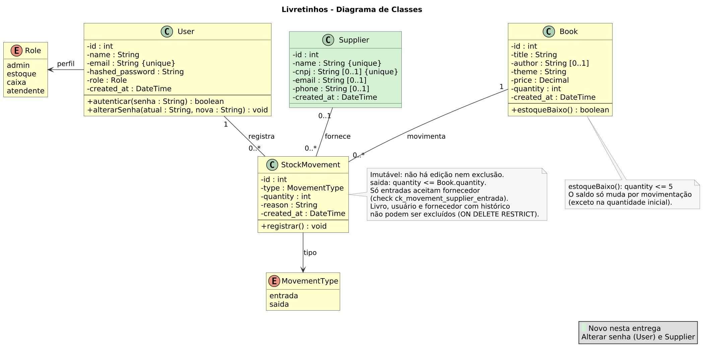
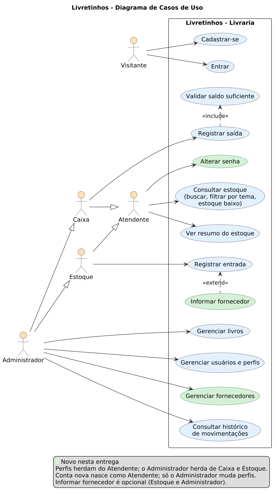

# Livretinhos

Sistema de administracao de livraria com FastAPI, React, PostgreSQL e Docker Compose.

## Executar

Copie `.env.example` para `.env` e configure as variaveis. No WSL, a partir da pasta deste projeto:

```sh
docker compose up --build -d
```

O frontend fica em http://localhost:5173 e a documentacao da API em http://localhost:8000/docs. O backend aplica as migrations ao iniciar.

## Administrador inicial

Depois de aplicar a migration, cadastre `admin@email.com` pela tela de login se a conta ainda nao existir. Escolha a senha no cadastro. Em seguida, no WSL:

```sh
docker compose exec -T backend python -m app.promote_admin admin@email.com
```

O comando falha sem alterar dados se a conta nao existir. Contas publicas e contas existentes na migration comecam como `atendente`; um administrador pode alterar seus perfis no painel. Novos bancos precisam repetir a promocao.

## Estoque e testes

A quantidade inicial e informada ao cadastrar o livro. Depois, entradas e saidas devem ser registradas como movimentacoes. Registros com historico nao podem ser excluidos.

```sh
docker compose exec -T backend python -m unittest discover -s tests -v
```

Caso use um seed SQL local, revise seu conteudo antes de executa-lo: alguns seeds atualizam quantidade e preco de titulos existentes e podem sobrescrever saldos atuais.

## Fornecedores

O administrador cadastra, edita e exclui fornecedores na tela **Fornecedores** (nome obrigatorio e unico; CNPJ, email e telefone opcionais). Ao registrar uma **entrada** de estoque, administrador e estoque podem escolher um fornecedor, e o historico passa a mostrar a coluna Fornecedor. Saidas nao aceitam fornecedor, e fornecedor com movimentacoes nao pode ser excluido. Movimentacoes anteriores a este recurso ficam sem fornecedor.

## Alterar senha

Todo usuario logado troca a propria senha em **Alterar senha**, informando a senha atual e a nova (6 a 100 caracteres, diferente da atual). O token JWT e sem estado: sessoes abertas antes da troca continuam validas ate expirar (60 minutos).

## Diagramas

Em [docs/diagramas](docs/diagramas): diagrama de classes e diagrama de casos de uso, escritos em PlantUML (`.puml`) com os PNG gerados. O que e novo nesta entrega aparece em verde.





Para gerar os PNG de novo depois de editar os `.puml` (no WSL, a partir da pasta do projeto):

```sh
docker run --rm -v "$PWD/docs/diagramas:/data" plantuml/plantuml -charset UTF-8 -tpng /data/classes.puml /data/casos-de-uso.puml
```
